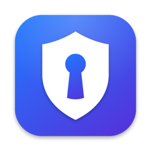
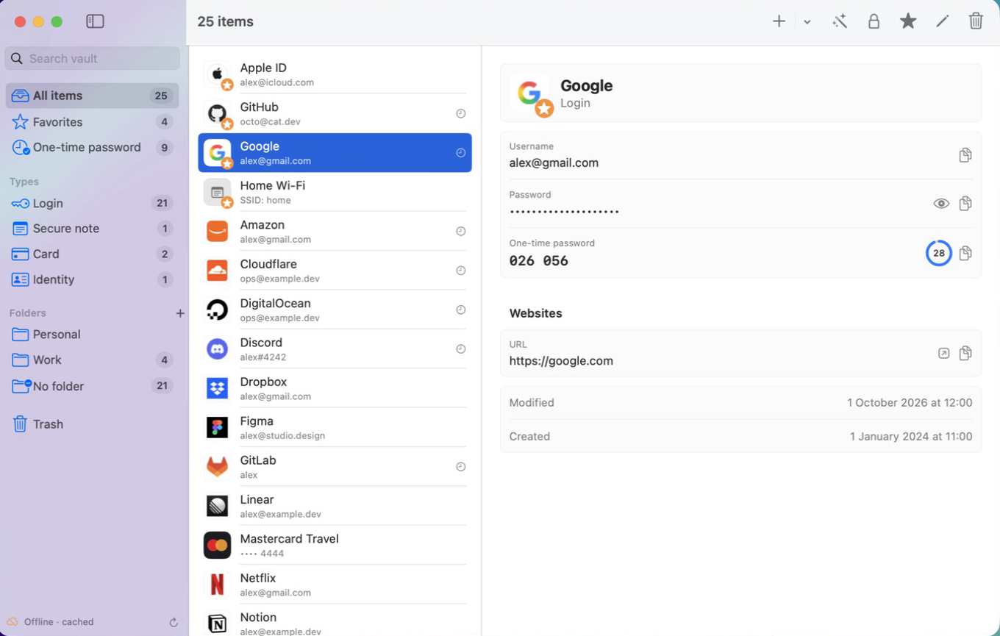

<p align="center"></p>

<h1 align="center">Slimwarden</h1>

<p align="center"><b>A featherweight native macOS client for Vaultwarden and Bitwarden.</b><br>
SwiftUI, no Electron, no JVM. A 2 MB app that idles at under 100 MB of memory with a 2,000-item vault.</p>

<p align="center"></p>

## Why

Desktop password managers built on Electron or Compose/JVM routinely sit at 0.5–1.5 GB of RAM just to show a list.
Slimwarden does the everyday things natively and nothing else.

| | Slimwarden | Typical JVM / Electron client |
|---|---|---|
| App size | ~2 MB | 150–400 MB |
| Memory, 2,000 items | ~95 MB | 500 MB – 1.4 GB |
| Cold unlock + decrypt | < 0.5 s | seconds |

## Features

- Log in to **any self-hosted Vaultwarden** or Bitwarden server (authenticator-app and email two-step login)
- **Works offline**: the encrypted vault is cached locally, so a server outage doesn't lock you out
- Instant search, **favorites pinned on top**, folders (create / rename / delete / move), types, one-time-password filter, trash
- View, **edit**, create, trash, restore and permanently delete items. Passkeys, attachments and unknown fields are preserved on edit
- **Copy any field** in one click. The clipboard is marked concealed and cleared after 90 s
- Live **TOTP** codes (otpauth://, plain base32, Steam Guard)
- **Password generator** with encrypted history
- Website icons through your own server's icon service, plus card brand badges
- **Touch ID unlock**, or don't lock at all. You choose in Settings
- **Menu bar mode**: closing the window keeps Slimwarden in the menu bar, with quick copy for favorites
- Locks on sleep / screen lock and with ⌘L

## Install

```bash
brew install --cask sanasol/tap/slimwarden
```

Or download the notarized zip from [Releases](https://github.com/sanasol/slimwarden/releases).

Requires macOS 14 Sonoma or later.

## Security model

- Standard Bitwarden client crypto: PBKDF2-SHA256 or Argon2id master key, HKDF-stretched, AES-256-CBC + HMAC-SHA256 per field, RSA-OAEP organization keys, per-item cipher keys.
- The master password and decrypted vault never touch the disk. The local cache is the server's encrypted sync payload.
- The refresh token is stored encrypted with your vault key.
- With **Touch ID** or **Don't lock**, the vault key is kept in your login keychain. The item is only readable by Slimwarden's code signature, and in Touch ID mode the app requires a fingerprint before reading it. Choose "Master password" in Settings to keep the key only in memory.
- Network traffic goes only to the server you log in to (including website icons via its `/icons` service).

## Build from source

```bash
git clone https://github.com/sanasol/slimwarden && cd slimwarden
./scripts/build-app.sh          # → build/Slimwarden.app
swift test
```

`build-app.sh` signs with your Developer ID if one is installed (override with `SIGN_IDENTITY`), ad-hoc otherwise.
`./scripts/release.sh` builds, notarizes and zips a release (see the script for the required notary profile).
`swift scripts/make-icon.swift` regenerates the app icon.

## Credits

Argon2 is the vendored [reference implementation](https://github.com/P-H-C/phc-winner-argon2) (CC0 / Apache-2.0).

Slimwarden is an independent project. It is not affiliated with or endorsed by Bitwarden Inc. or the Vaultwarden project.

## License

MIT
